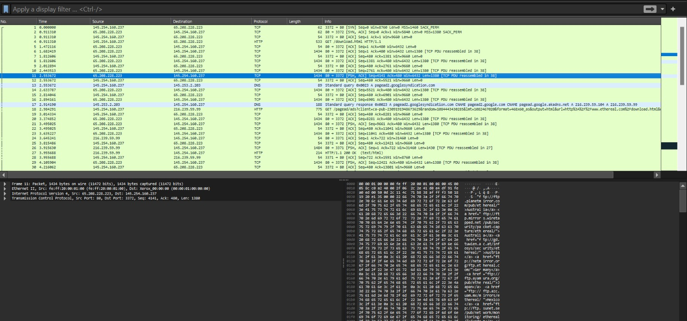
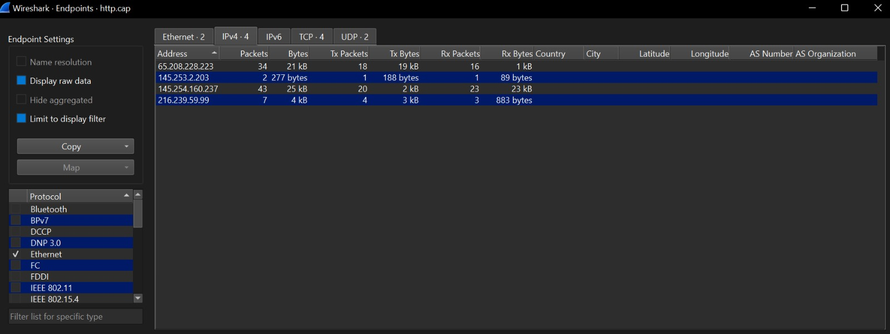
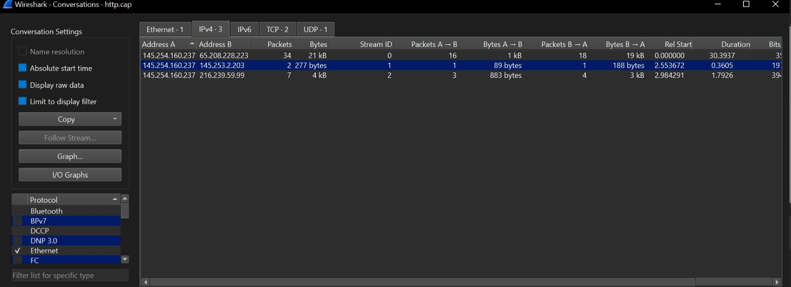
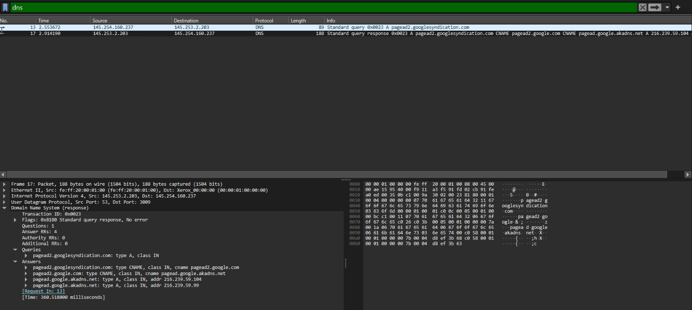
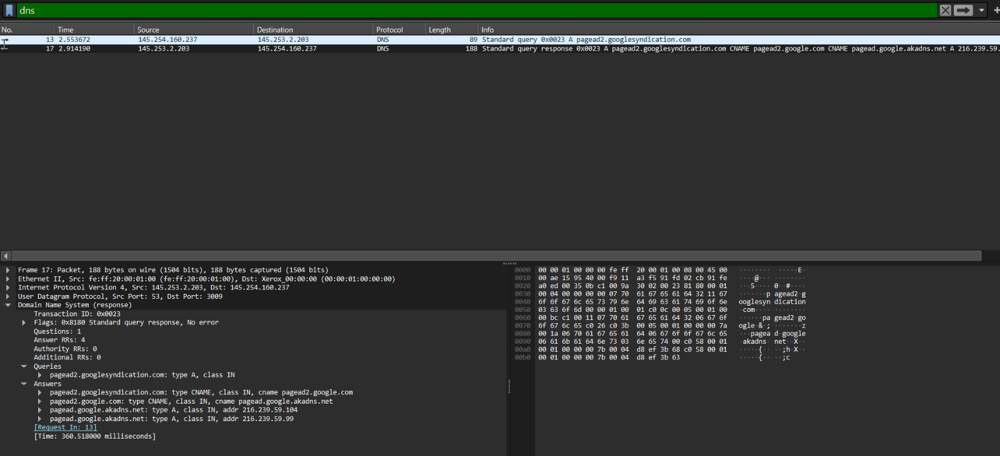
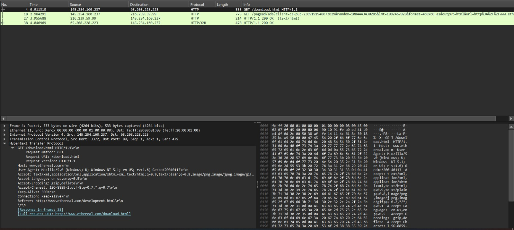
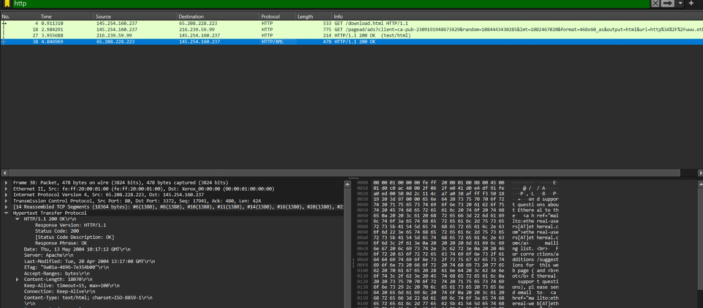
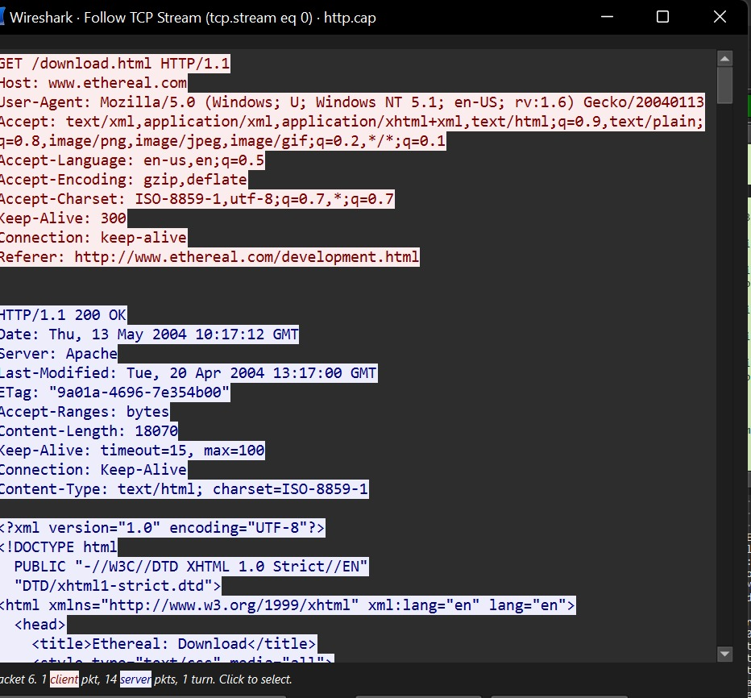
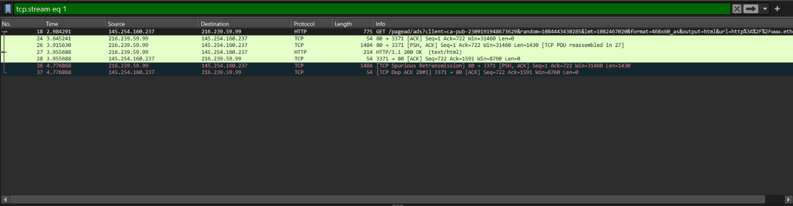

# Wireshark PCAP Analysis

## Project Overview

This project involves analyzing captured network traffic using Wireshark to understand how devices communicate over a network.

Using the `http.cap` packet capture, I investigated network endpoints, communication between hosts, DNS queries and responses, HTTP requests and responses, and TCP streams.

## Objective

The objective was to examine captured network packets, identify the systems communicating, understand how domain names are resolved to IP addresses, and investigate the exchange of HTTP requests and responses.

## Tools Used

- Wireshark
- HTTP PCAP file (`http.cap`)
- Windows

## Network Traffic Analysis

The `http.cap` packet capture was opened in Wireshark to examine the network traffic recorded in the file. The capture contained 43 packets.

The initial analysis showed different types of network communication, including TCP, UDP, DNS, and HTTP traffic. Display filters and Wireshark's Statistics tools were used to examine the packets and identify the communicating endpoints.

This initial inspection provided a starting point for investigating the hosts, DNS resolution, HTTP requests, and TCP conversations in the capture.

## Endpoint Analysis

The IPv4 Endpoints feature in Wireshark was used to identify the IP addresses involved in the captured network traffic.

Four IPv4 endpoints were observed:

| IP Address | Packets |
|---|---:|
| 65.208.228.223 | 34 |
| 145.253.2.203 | 2 |
| 145.254.160.237 | 43 |
| 216.239.59.99 | 7 |

The endpoint analysis helped identify the hosts involved in the captured communication. Further investigation of the packet details and conversations helped clarify the roles of these addresses.

## Conversation Analysis

Wireshark's Conversations feature was used to examine communication between the identified endpoints.

The IPv4 conversations showed traffic between:

- `145.254.160.237` and `65.208.228.223`
- `145.254.160.237` and `145.253.2.203`
- `145.254.160.237` and `216.239.59.99`

The TCP conversations included communication over port 80, commonly used by HTTP. A UDP conversation involving port 53 was also observed, which is commonly used for DNS queries.

This analysis helped connect the IP addresses to the protocols used during communication.

## DNS Investigation

DNS traffic was examined using the `dns` display filter in Wireshark.

The capture contained a DNS query for `pagead2.googlesyndication.com`. The response included a chain of canonical name (CNAME) records and resolved the domain through that chain to IP addresses including `216.239.59.104` and `216.239.59.99`.

The DNS server observed in the capture was `145.253.2.203`, while the querying client was `145.254.160.237`.

This investigation demonstrated how DNS helps a client resolve a domain name to IP addresses before communicating with a server.

## HTTP Investigation

HTTP traffic was examined using the `http` display filter in Wireshark.

The analysis identified two HTTP GET requests:

- `GET /download.html` sent to `www.ethereal.com`, with the destination IP address `65.208.228.223`.
- `GET /pagead/ads` sent to `pagead2.googlesyndication.com`, with the destination IP address `216.239.59.99`.

Both conversations contained an `HTTP/1.1 200 OK` response, indicating that the servers returned successful HTTP responses.

The request headers also provided additional information, including the Host, User-Agent, and Referer fields. These details helped explain which resources the client requested and the webpage associated with the additional request.

## TCP Stream Analysis

Wireshark's Follow TCP Stream feature was used to inspect the contents of TCP conversations.

The first stream examined contained the request for `/download.html`, followed by an `HTTP/1.1 200 OK` response from the server. The request headers identified `www.ethereal.com` as the Host.

A second stream was examined to investigate the request for `/pagead/ads` associated with `pagead2.googlesyndication.com`. Its response also contained an `HTTP/1.1 200 OK` status.

The display filter `tcp.stream eq 1` was then applied to isolate one TCP conversation, which displayed seven packets. This demonstrated how Wireshark can group packets belonging to the same TCP stream and help analysts inspect a conversation more clearly.

## Key Findings

- Four IPv4 endpoints were identified in the captured traffic.
- TCP communication over port 80 and UDP communication involving port 53 were observed.
- DNS traffic resolved `pagead2.googlesyndication.com` through a CNAME chain to IP addresses including `216.239.59.99`.
- The client requested `/download.html` from `www.ethereal.com` and received an `HTTP/1.1 200 OK` response.
- The client also requested `/pagead/ads` from `pagead2.googlesyndication.com`, and the server returned an `HTTP/1.1 200 OK` response.
- Following TCP streams made it easier to examine HTTP requests and responses together.

The observations describe the traffic in this capture; they do not, by themselves, establish that the activity was malicious.

## Conclusion

This project provided practical experience using Wireshark to inspect and interpret captured network traffic. By examining endpoints, conversations, DNS records, HTTP requests, and TCP streams, I developed a better understanding of how clients communicate with servers.

The investigation also showed the value of connecting evidence across multiple packets rather than interpreting each packet in isolation. These skills provide a foundation for further learning in network troubleshooting and cybersecurity traffic analysis.
